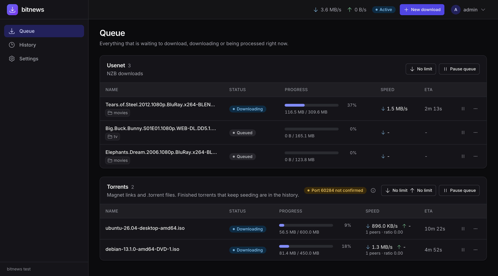

# bitnews

A self-hosted download daemon for your homelab. It fetches from **Usenet** and **BitTorrent**, repairs and unpacks what it gets, and hands finished files to **Sonarr, Radarr and Prowlarr**, which talk to it as if it were SABnzbd or qBittorrent. One static binary, one port, one web UI.



## What it does

### One queue for both protocols

- Usenet (NZB) and torrents (`.torrent` files and magnet links) are the same kind of thing in bitnews: a **Download** with a category, a priority and a lifecycle.
- Each protocol has its own queue and concurrency limit (1 Usenet, 5 torrents by default). Pause a queue or a single download, set priorities (`force`, `high`, `normal`, `low`), and set speed limits globally or per protocol.
- A download is only reported as complete once it is **Ready**: fetched, verified, repaired and unpacked. Sonarr and Radarr never import half-finished files, and a failed download is reported as failed so they can pick another release.
- Live progress in the browser over server-sent events. Light and dark theme, usable on a phone.

### Usenet

- Several news servers with a **server priority**: lower numbers are tried first, servers with the same priority share load, and higher ones only get the articles the others don't have. Retention is respected per server.
- Strict TLS only: certificates are always verified, there is no plaintext NNTP and no skip-verify switch.
- Its own NZB parser, NNTP client and yEnc decoder. Articles are written straight to their offset in pre-allocated files, with a CRC32 check per part.
- Downloads resume after a restart.
- PAR2 **verify and repair** and RAR / 7z / zip **unpack** (multi-volume and password-protected too), including renaming of obfuscated files. Fetching the next download carries on while the previous one is post-processed.
- Optional built-in versions of the two popular [TRaSH](https://trash-guides.info/) SABnzbd scripts: clean release names when an NZB is added, and dots for underscores after unpacking.

### BitTorrent

- DHT, PEX and MSE encryption, switched off automatically for private torrents. Magnet links, `.torrent` upload and URLs.
- Share limits (ratio and seeding time) globally and per torrent. Seeding continues after a download is Ready, and bitnews never modifies the original files, so hardlinks keep working.
- **VPN friendly.** Bind torrent and Usenet traffic to a network interface: if the VPN goes down, the traffic stops instead of leaking over your normal route. Port forwarding from gluetun (for example with ProtonVPN) is picked up live, without a restart, and the queue shows whether peers can actually reach you.
- No UPnP or NAT-PMP, ever.

### Works with what you already run

| You use | bitnews offers |
|---|---|
| Sonarr, Radarr (Usenet) | a SABnzbd-compatible API at `/sabnzbd/api` |
| Sonarr, Radarr (torrents) | a qBittorrent WebUI v2 compatible API at `/api/v2` |
| Scripts and your own tools | a JSON API at `/api/v1` with one app key |

The UI, the API and both adapters share the same port. Follow the [TRaSH guides](https://trash-guides.info/) folder layout (one `/data` mount shared by all containers) and no remote path mapping is needed.

### Security by design

- Written in Go, a memory-safe language. Every parser of hostile input (NZB, NNTP, yEnc, archive listings, file names) has a fuzz target.
- The only subprocesses are the pinned `7zz` and `par2` tools, started without a shell and with a scrubbed environment. Archive listings are checked before extraction, and entries with `..`, absolute paths, symlinks or special files are rejected.
- Server and archive passwords are encrypted at rest with a master key stored apart from the database. Login passwords use argon2id. Secrets never reach the logs.
- The container runs read-only with all capabilities dropped, as `PUID:PGID`, never as root.

## Quick start (Docker)

```sh
mkdir bitnews && cd bitnews
curl -O https://raw.githubusercontent.com/jroosing/bitnews/main/deploy/docker-compose.example.yml
mv docker-compose.example.yml docker-compose.yml
# Edit PUID, PGID, TZ and the /data path, then:
docker compose up -d
docker compose logs bitnews      # prints the one-time setup token
```

Open `http://<host>:9494`, enter the setup token, create the admin account, add your Usenet server under **Settings → Servers**, and copy the app key from **Settings → Security** into Sonarr and Radarr.

The image is `ghcr.io/jroosing/bitnews` (linux/amd64). bitnews speaks plain HTTP: put a reverse proxy in front of it for TLS and do not expose it to the internet. See the [deployment guide](docs/deploy.md) for configuration, the master key, VPN and port forwarding, the `/data` layout and hardening.

## Documentation

- [Deployment guide](docs/deploy.md)
- [Own API v1](docs/api-v1.md) and the [qBittorrent adapter](docs/adapters-qbit.md)
- [Network binding](docs/network-binding.md)
- [Architecture](docs/architecture.md)
- [Glossary](CONTEXT.md)
- [Decisions (ADRs)](docs/adr/)
- [Milestones and issue specs](docs/milestones/README.md)

## Development

You need Go 1.27.3 or later. Lint and vulnerability tools are pinned in `go.mod` and run through `go tool`, so there is nothing else to install.

```sh
make fmt         # gofmt -s -w (fmt-check only reports)
make fix         # go fix ./... (fix-check only reports)
make test        # go test -race ./... (what CI runs)
make e2e         # the end-to-end tests of the daemon (tag e2e), local only
make lint        # go vet + staticcheck
make vuln        # govulncheck
make fuzz-smoke  # every Fuzz* target for 10s
make build       # static binary in bin/
```

## License

bitnews is free software under the [GNU General Public License v3.0](LICENSE), the same license as Sonarr and Radarr. 7-Zip and par2cmdline-turbo, which the image ships for post-processing, keep their own licenses and run as separate programs.
